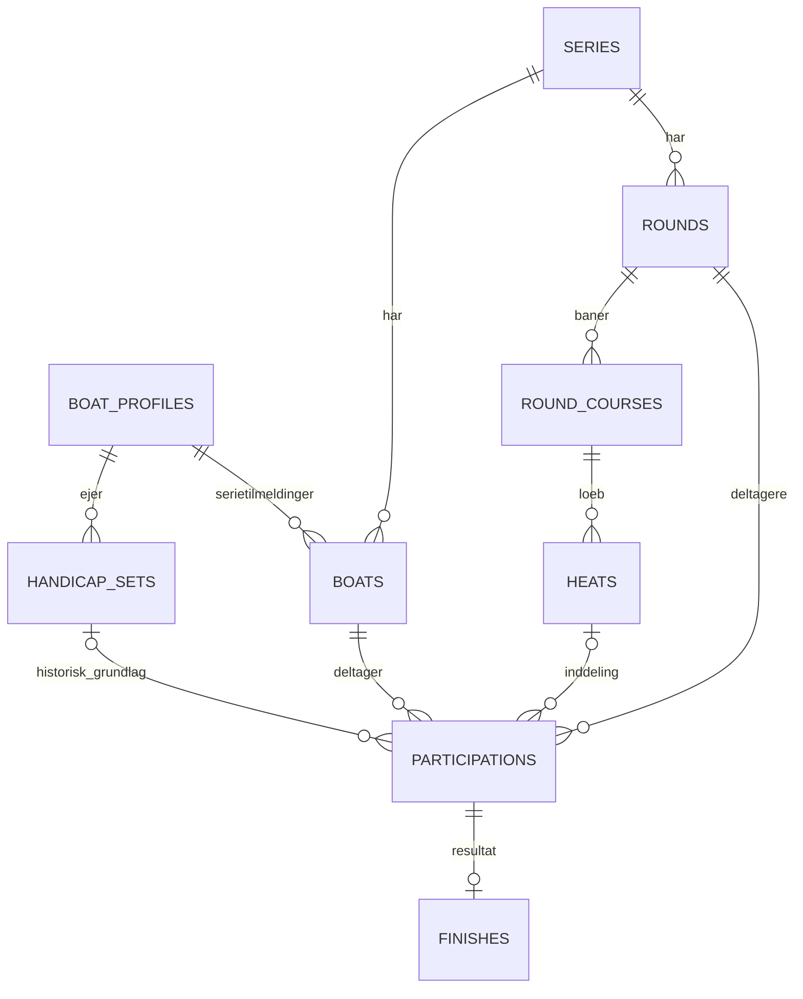

# Onsdagsbanen v2: struktur og ansvar

Version 1 er gemt i commit `8f4d797`. Refaktoreringen ændrer navigationen, modulgrænserne og datamodellen samlet.

## Arbejdsområder

| Adresse | Formål |
| --- | --- |
| `/results` | Offentlige resultater, delbare valg og PDF |
| `/today` | Genvej til det aktuelle eller næste åbne ræs |
| `/series` | Opret og vælg serie |
| `/series/{id}` | Seriens ræs, datoer, fremdrift og offentliggørelse |
| `/series/{id}/boats` | Serietilmeldinger og afmelding af tomme tilmeldinger |
| `/series/{id}/assignments` | Både og løbsinddeling i et stort arbejdsområde |
| `/series/{id}/results` | Seriens samlede resultater |
| `/series/{id}/settings` | Seriens standarder og indstillinger |
| `/rounds/{uid}/setup` | Dato, starttider, bane og beregningsgrundlag |
| `/rounds/{uid}/starts` | Ræsets startlister |
| `/rounds/{uid}/timing` | Fælles måltagning for begge baner |
| `/rounds/{uid}/results` | Resultater for netop dette ræs |
| `/rounds/{uid}/history` | Administratorens ændringshistorik for ræset |
| `/boats` | Fælles bådregister og handicapsæt |
| `/admin` | Brugeradgang og samlet ændringshistorik |

Browserens tilbage/frem og genindlæsning bevarer arbejdsområdet. Løbsinddelingen gemmer løb, interval, søgning og filter i URL'en. Kun små, afgrænsede opgaver som profilredigering og bekræftelse åbner en dialog.

## Datamodel

`boat_profiles` er den fælles bådidentitet. `boats` er tilmeldingen i én serie. Nye profiler tilmeldes ikke automatisk en serie. Tomme serietilmeldinger kan afmeldes uden at slette profilen.

`participations` er den eneste lagrede deltagerliste, med primærnøglen `(round_id, boat_id)`. En båd kan derfor kun være i ét løb i samme ræs i serien. Planlagte deltagelser kan mangle dato og baneopsætning. Ræsets permanente UUID bruges i navigationen; navn og dato er aldrig identitet. Andre serier spærrer ikke for genbrug.

Når banen indstilles, får deltagelsen start, distance og reference til et uforanderligt handicapsæt. Senere ændringer i bådregisteret omskriver ikke historikken. `entries` og `heat_boats` er SQL-views med skrivetriggere over `participations`, så eksisterende beregningskode bruger samme datagrundlag.

Sletning fra det fælles register blokeres af enhver deltagelse i alle serier, også planlagte ræs uden dato. Dialogen viser kun anvendelsen. Afmelding fra ræs kræver manuel navigation og fjernelse ét ræs ad gangen. Resultater slettes ikke gennem bådregisteret.

## Kodegrænser

- `app.py`: WSGI, login, sikkerhedsheaders og statiske ressourcer.
- `api.py`: HTTP-adaptere, adgangskontrol og transaktionernes kald til applikationslaget.
- `services/`: operationer for serier, både, deltagelse, måltagning, resultater og rettelser. `service.py` bevarer et lille fælles eksportsted for eksisterende kald.
- `fleet.py`, `hierarchy.py`, `planning.py`, `handicaps.py`, `timing.py`, `calculations.py`: regler for de respektive fagområder.
- `workspaces.py`: læsemodeller til serieoversigt, ræsstatus og afgrænset historik.
- `store.py`, `migrations.py`, `schema/`: forbindelser, versionsstyrede migreringer og databasesikrede relationer.
- `static/core/`: API-klient, routing, navigation, fælles visning og tilstand.
- `static/features/`: selvstændige visninger for resultater, måltagning, serier, ræs, både, løbsinddeling og adgang.

Frontend bruger browserens native ES-moduler uden et JavaScript-byggetrin. Tilstanden er adskilt for offentlige resultater, ræsresultater, måltagning, planlægning, bådregister og løbsinddeling.

`unconfigured.py` gemmer faktiske måltider og statusser før baneopsætningen. Skemaversion 3 tilføjer `pending_finishes` med relation til deltagelsen og `round_captures` med relation til ræset. Når banen indstilles, knyttes observationerne til beregningsgrundlaget i samme transaktion. Måltid, straftid og registreringsnøgle bevares. Hvis opsætningen ikke kan anvendes på tiderne, rulles opsætningen tilbage, og observationerne bevares til rettelse. Der oprettes ingen kunstig dato, distance eller beregnet tid for at begynde måltagningen.

Måltagningssiden viser tilmeldte både, også før en bane er indstillet. Hver bane har en opsætningsknap for det aktuelle ræs; dato og starttider kan også indstilles her. Afslutning og offentliggørelse kræver opsætning af alle baner med deltagere.

## Gemning og status

Tider uden en valgt båd er fjernet. Skemaversion 5 arkiverer den tidligere løse kø med auditspor og bevarer alle bådenes registreringer. Nye HTTP-kald til oprettelse af løse tider returnerer 410. Frontend arkiverer gamle lokale kladder uden båd separat og bevarer kladder med en valgt båd, så de kan bekræftes direkte. Legacy-tabeller og læsefunktioner bevares for historik og sporbarhed.

`compatibility.py` definerer det nødvendige handicap for tilmeldinger og ændringer af beregningsmål/vind. For planlagte ræs uden valgt vind anvendes M. Kendte ræs bruger præcis deres valgte tal og et eventuelt historisk handicapsæt. Fejl returnerer bådidentitet, nødvendige felter og kontekst, så frontend kan åbne redigering og bevare den oprindelige formular eller løbsinddeling. Den udtrykkelige rettelse af et historisk sæt supplerer kun manglende felter i den konkrete deltagelse og opretter et nyt uforanderligt sæt.

`reference_clock.py` gemmer korrektionen i `round_clocks`. `clock_sources` og `clock_capture_sources` angiver, hvilke tider der stammer fra sidens ur. Synkronisering flytter kun disse tider, opdaterer deres beregnede tider og genberegner eventuel jagtstartsrækkefølge i én transaktion. Manuel tidsindtastning fjerner automatisk tilknytningen til sidens ur. Frontend bevarer samme skelnen for lokale, ubekræftede tider. Skemaversion 4 genkender tidligere klik-tider på deres bevarede delsekunder; importerede tider ændres ikke. Migreringen flytter ingen tider.

Pilene i løbsinddelingen gemmer straks og samlet på serveren. Visningen flytter først bådene efter et bekræftet svar. Gentagelse efter et tabt svar opretter ikke dubletter. Tilføjelse/flytning kan gælde hele serien, fremover, bagudrettet eller ét ræs; fjernelse kræver ét ræs.

Fremdrift (`Planlagt`, `Klar`, `I gang`, `Afsluttet`) og offentliggørelse er separate tilstande. Afslutning gemmer DNC og dommertider; offentliggørelse er en særskilt handling. Rettelser af historisk beregningsgrundlag kræver forhåndsvisning og gør berørte resultater til kladder. Rettelser fra et ræs afgrænses med UUID, også hvis flere ræs har samme dato.

## Migrering og verifikation

SQLite `PRAGMA user_version` styrer migreringerne. V1 til v2 konverterer deltagerlisterne i én transaktion, kontrollerer fremmednøgler og bevarer ID'er, tider, historiske handicapsæt og ræsets UUID. Gentagen opstart kører ikke konverteringen igen. Tag en SQLite-backup før opgradering; en v2-database kan ikke åbnes med v1-koden.

Backendtestene ligger i `tests/onsdagsbane/test_*.py`. `v2-browser.py` afprøver administrationens samlede arbejdsgang mod en isoleret preview-server. `results-browser.py` afprøver offentlig navigation, deling og browserpræferencer mod en server med det importerede eksempelmateriale. De tidligere browsertests for v1-navigationen er erstattet af disse.
